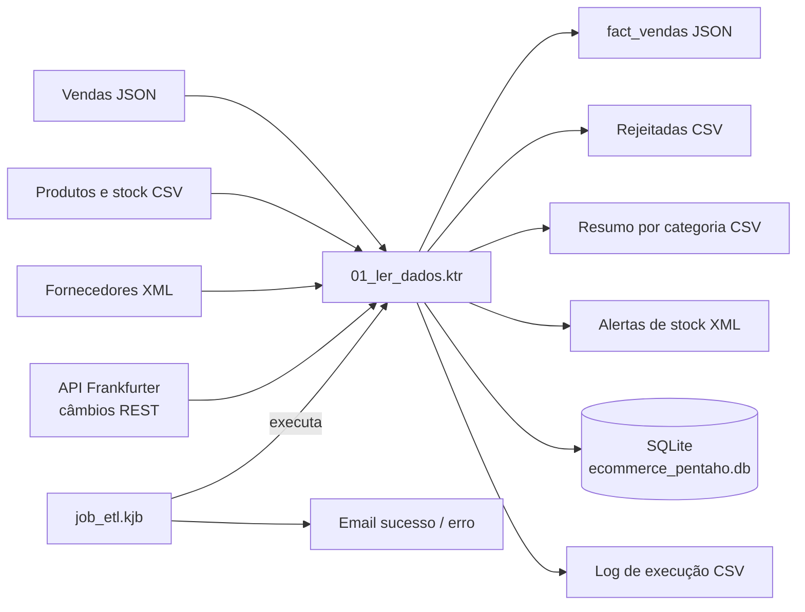

# Gestão de Stocks e Vendas em E-Commerce

**Trabalho Prático I — Integração de Sistemas de Informação**  
Licenciatura em Engenharia de Sistemas Informáticos · IPCA · 2026/27

**Autores:** Gonçalo Braga (nº 31508) — Pentaho · Gonçalo Rodrigues (nº 31507) — KNIME · Trabalho de grupo  
**Repositório:** [braguex10/ISI-TP1-Ecommerce-ETL](https://github.com/braguex10/ISI-TP1-Ecommerce-ETL)

| Material | Localização / estado |
|---|---|
| Relatório em PDF | Pendente; a incluir em [`docs/`](docs) |
| Transformação Pentaho | [01_ler_dados.ktr](pentaho/01_ler_dados.ktr) |
| Job Pentaho | [job_etl.kjb](pentaho/job_etl.kjb) |
| Workflow KNIME | [TP1_Ecommerce_ETL.knwf](knime/TP1_Ecommerce_ETL.knwf) |
| Vídeo de demonstração | Pendente de gravação e inclusão do link |
| QR Code do vídeo | Pendente do link definitivo; a incluir no relatório |

## Sobre o projeto

Uma loja online de periféricos e mobiliário de escritório recebe dados de vendas, de stock e de fornecedores em sistemas separados, em formatos diferentes e com problemas de qualidade. Este projeto integra essas fontes, valida e corrige os dados, protege os dados pessoais dos clientes e produz indicadores de vendas, margens e alertas de stock.

O processo foi implementado em duas plataformas, cada uma por um elemento do grupo, sobre os mesmos dados de entrada: **Pentaho Data Integration** (Gonçalo Braga) e **KNIME** (Gonçalo Rodrigues). Em Pentaho, a transformação lê ficheiros JSON, CSV e XML e consulta uma API REST de câmbios. Depois limpa, valida e cruza os dados, calcula totais, custos e margens, separa as vendas válidas das rejeitadas e grava os resultados em JSON, CSV, XML e numa base de dados SQLite. Um job orquestra a execução, regista logs e envia notificações por email.

Todos os dados são **sintéticos**, incluindo nomes, emails, NIF e telefones. Foram criados com erros propositados para testar a limpeza: um email inválido, NIF com e sem prefixo `PT`, telefones com e sem indicativo e com espaços, um stock vazio, uma categoria com erro ortográfico e um produto vendido sem fornecedor. Os valores estão em euros e **sem IVA**. A margem calculada é `total da linha − custo do fornecedor`; não inclui portes, impostos ou outros custos da loja.

## Arquitetura



## Tecnologias

| Tecnologia | Utilização |
|---|---|
| Pentaho Data Integration 10.2 — Spoon | Desenvolvimento e execução da transformação e do job (Gonçalo Braga) |
| Kitchen | Execução do job pela linha de comandos |
| KNIME Analytics Platform | Implementação paralela do mesmo processo ETL (Gonçalo Rodrigues) |
| SQLite | Persistência dos resultados (sem servidor; a base é um ficheiro) |
| API Frankfurter | Taxas de câmbio EUR → USD/GBP do Banco Central Europeu |
| Gmail SMTP | Notificações por email no fim do job |
| Git e GitHub | Histórico e disponibilização do projeto |

## Organização dos ficheiros

```text
ISI-TP1-Ecommerce-ETL/
├── README.md
├── data/                        Fontes sintéticas JSON, CSV e XML (partilhadas)
│   ├── vendas_online.json
│   ├── produtos_stock.csv
│   └── fornecedores_precos.xml
├── pentaho/
│   ├── 01_ler_dados.ktr         Transformação (fases E, T e L)
│   └── job_etl.kjb              Job de orquestração, logs e email
├── knime/
│   └── TP1_Ecommerce_ETL.knwf   Workflow KNIME
├── output/
│   ├── pentaho/                 Resultados gerados pelo job Pentaho
│   └── knime/                   Resultados gerados pelo workflow KNIME
├── sql/
│   └── knime_sqlite_consultas.sql
└── docs/                        Relatório
```

A pasta `output/` está versionada com os resultados de uma execução de referência; os ficheiros são substituídos a cada nova execução, exceto os logs, que acumulam linhas. Manter a estrutura das pastas ao copiar o projeto.

## Processo ETL

| Ficheiro / bloco | Operações |
|---|---|
| [01_ler_dados.ktr](pentaho/01_ler_dados.ktr) — Extração | Ler JSON e desdobrar as linhas de venda (`$[*].sku`), ler CSV (`;`, UTF-8), ler XML por atributos (`//produto`), chamar a API de câmbios com REST Client e ler `$.date`, `$.rates.USD` e `$.rates.GBP` |
| [01_ler_dados.ktr](pentaho/01_ler_dados.ktr) — Limpeza e validação | Remover duplicados por transação e SKU, validar emails com regex, retirar o prefixo `PT` do NIF, tirar espaços e acrescentar `+351` ao telefone, stock nulo → 0, corrigir `Monitroes` → `Monitores` |
| [01_ler_dados.ktr](pentaho/01_ler_dados.ktr) — Integração e cálculo | Stream lookup com produtos e fornecedores, calcular total, custo e margem, juntar as taxas do dia e converter para USD e GBP, classificar o stock (RUTURA / CRITICO / OK) |
| [01_ler_dados.ktr](pentaho/01_ler_dados.ktr) — Filtragem e anonimização | Separar vendas válidas e rejeitadas, filtrar stock baixo, mascarar NIF, email e telefone, agrupar por categoria |
| [01_ler_dados.ktr](pentaho/01_ler_dados.ktr) — Carregamento | Exportar JSON, CSV e XML, inserir em 4 tabelas SQLite (truncate + insert), acrescentar uma linha ao log de execução |
| [job_etl.kjb](pentaho/job_etl.kjb) | Executar a transformação, gravar o log do job, enviar email de sucesso ou registar a falha, enviar email de erro e terminar com Abort job |
| [TP1_Ecommerce_ETL.knwf](knime/TP1_Ecommerce_ETL.knwf) | Mesmo processo em KNIME: leitores CSV/JSON/XML, GET Request, String Manipulation, Rule Engine, Joiner, Math Formula, GroupBy, escritores JSON/CSV/XML e DB Writer em SQLite |

**Expressões regulares utilizadas**

| Objetivo | Expressão | Substituição |
|---|---|---|
| Validar email | `^[\w.+-]+@[\w-]+\.[\w.]+$` | — |
| Retirar prefixo do NIF | `^PT` | *(vazio)* |
| Retirar espaços do telefone | `\s` | *(vazio)* |
| Acrescentar indicativo | `^(\d{9})$` | `+351$1` |
| Anonimizar NIF | `^(\d{3})\d{5}(\d)$` | `$1*****$2` |
| Anonimizar telefone | `^(\+351\d{3})\d{3}(\d{3})$` | `$1***$2` |
| Anonimizar email | `^(.).*(@.*)$` | `$1***$2` |

## Como executar noutro computador

### 1. Requisitos e obtenção do projeto

Instalar o PDI/Spoon e um Java compatível. O ambiente testado usa PDI 10.2. É necessária **ligação à internet**, porque a transformação consulta a API de câmbios. O KNIME só é necessário para abrir o workflow do segundo elemento. Não são necessários servidor de base de dados, Python, Docker, Node-RED ou broker MQTT.

Descarregar o repositório ou cloná-lo:

```text
git clone https://github.com/braguex10/ISI-TP1-Ecommerce-ETL.git
```

### 2. Base de dados

Não é preciso preparar nada. A ligação **SQLite_Ecommerce** (tipo SQLite, Native JDBC) aponta para `output/pentaho/ecommerce_pentaho.db` e o PDI já inclui o driver. Se o ficheiro não existir, é criado na primeira execução.

As tabelas criadas são:

- `fact_vendas`: vendas válidas, com os dados do cliente anonimizados;
- `vendas_rejeitadas`: vendas rejeitadas, sem dados pessoais;
- `resumo_categoria`: unidades, total vendido, margem e nº de vendas por categoria;
- `dim_produto`: catálogo limpo, com o `estado_stock`.

### 3. Configurar o email (opcional)

Os passos **Email Sucesso** e **Email Erro** do job usam o Gmail. Para receber as notificações, preencher em cada um:

| Campo | Valor |
|---|---|
| SMTP Server | `smtp.gmail.com` |
| Port | `587` |
| Authentication user | Conta Gmail de quem executa |
| Authentication password | Palavra-passe de aplicação Gmail (myaccount.google.com/apppasswords) |
| Secure connection type | `TLS` |
| Destination / Sender address | Email de destino e email da conta |

Não é necessária a palavra-passe dos autores. Não publicar palavras-passe pessoais no Git. Sem esta configuração, o job corre na mesma: o email falha, mas o processo termina com sucesso.

### 4. Executar o job

Fechar os CSV de saída no Excel, pois podem bloquear a escrita. No Spoon, abrir `pentaho/job_etl.kjb` e carregar em **Run**.

```text
START → Executar ETL → Email Sucesso → Success
              └─(falha)→ Registar Erro → Email Erro → Abort job
```

Não é necessário abrir a transformação; o job executa-a. A transformação e o job usam `${Internal.Entry.Current.Directory}/../data/...` e `.../../output/pentaho/...`. Assim, não é preciso alterar caminhos no Spoon quando a pasta é copiada para outro computador, desde que a estrutura seja mantida.

Alternativa pela linha de comandos do Windows, substituindo os caminhos:

```cmd
"C:\caminho\data-integration\Kitchen.bat" /file:"C:\caminho\ISI-TP1-Ecommerce-ETL\pentaho\job_etl.kjb" /level:Basic
```

**KNIME:** File → Import KNIME Workflow → `knime/TP1_Ecommerce_ETL.knwf`; ajustar, se necessário, os caminhos das pastas `data/` e `output/knime/`; Execute All.

### 5. Verificar a carga e a reexecução

Abrir `output/pentaho/ecommerce_pentaho.db` com o DB Browser for SQLite, ou no Spoon com botão direito num passo de base de dados → **Explore**:

```sql
SELECT COUNT(*) AS vendas_validas,
       ROUND(SUM(total_linha), 2) AS total_vendas,
       ROUND(SUM(margem), 2) AS margem_total
FROM fact_vendas;
```

Com as fontes fornecidas, o resultado esperado é **2 vendas válidas, 538,80 EUR de vendas e 194,80 EUR de margem**. Repetir o job mantém as contagens: cada tabela é esvaziada (truncate) antes da inserção. O `log_execucao.csv` e o `job_etl.log` acumulam uma entrada por execução.

## Resultados e regras

| Entidade | Entrada | Resultado |
|---|---|---|
| Vendas | 3 transações com 5 linhas de venda | 2 válidas e 3 rejeitadas |
| Produtos | 8, um com stock vazio e um com categoria errada | 8 corrigidos; 4 em alerta (2 RUTURA, 2 CRITICO) |
| Fornecedores | 2 fornecedores com 6 produtos | Preço de custo e prazo de entrega por produto |
| Câmbios | 1 pedido à API por execução | Taxas USD e GBP do dia aplicadas a cada venda |
| Resumo por categoria | 2 vendas válidas | Mobiliário 379,00 € (margem 139,00 €); Periféricos 159,80 € (margem 55,80 €) |
| Log de execução | 1 execução | 1 linha com válidas, total, rejeitadas e data/hora |

As 3 vendas rejeitadas dividem-se assim: **2 por email inválido** (TXN-2026-002) e **1 por produto sem fornecedor** (SKU-1006). A validação do email é feita primeiro; uma venda com email inválido já não passa pela verificação do fornecedor.

- Uma venda só é válida com email válido **e** preço de custo conhecido.
- A regex de email verifica o formato, não a existência da caixa de correio.
- NIF e telefones são normalizados para um formato único antes da anonimização.
- Estado do stock: 0 → RUTURA; 1 a 4 → CRITICO; 5 ou mais → OK.
- Total = preço aplicado × quantidade; custo = preço de custo × quantidade; margem = total − custo.
- Os valores em USD e GBP dependem das taxas do dia de execução.
- Nos ficheiros e tabelas de saída não seguem nome, NIF, email ou telefone em claro (RGPD).

As duas implementações coincidem nos valores em euros: **2 válidas, 3 rejeitadas, 538,80 EUR e 4 alertas de stock**. A versão KNIME guarda também uma tabela `dim_cliente` com os clientes anonimizados; na versão Pentaho, esses dados anonimizados ficam diretamente na `fact_vendas`, seguindo o princípio da minimização de dados.

## Consulta das vendas detalhadas

O ficheiro `output/pentaho/fact_vendas.json` e a tabela `fact_vendas` guardam cada venda válida com transação, data, método de pagamento, cliente anonimizado, produto, categoria, quantidade, preço, custo, margem e prazo de entrega. O JSON inclui também a data e as taxas de câmbio e os totais em USD e GBP.

Consulta equivalente:

```sql
SELECT id_transacao, data_venda, nif_anon, email_anon,
       sku, Nome_Produto, Categoria, quantidade,
       preco_aplicado, total_linha, custo_total, margem
FROM fact_vendas
ORDER BY data_venda, id_transacao;
```

## Testes de execução

O job principal foi executado com sucesso várias vezes, verificando-se as contagens, os totais e a coincidência dos resultados em euros com a versão KNIME. A reexecução não duplica dados nas tabelas.

O envio de email está configurado nos dois ramos do job, mas, nos testes, a ligação SMTP foi cortada pela rede utilizada (`javax.mail.MessagingException: [EOF]`). O job foi desenhado para que uma falha no email não interrompa o processo: o ETL termina com `result=[true]`.

Para demonstrar o ramo de erro, alterar temporariamente no passo **Executar ETL** o nome da transformação para um ficheiro inexistente: a execução falha, passa por **Registar Erro** e **Email Erro** e termina em **Abort job**.

## Relatório e vídeo de demonstração

O relatório encontra-se em `docs/`. Inclui enquadramento, problema, estratégia, transformações, jobs, vídeo de demonstração (QR Code), conclusão e referências. As instruções de execução ficam neste README.

**Link do vídeo de demonstração:** ______________________________

Confirmar que o link do vídeo permite acesso ao docente antes da entrega.

**Gonçalo Braga · nº 31508** · **Gonçalo Rodrigues · nº 31507**  
Integração de Sistemas de Informação · LESI · 2026/27
